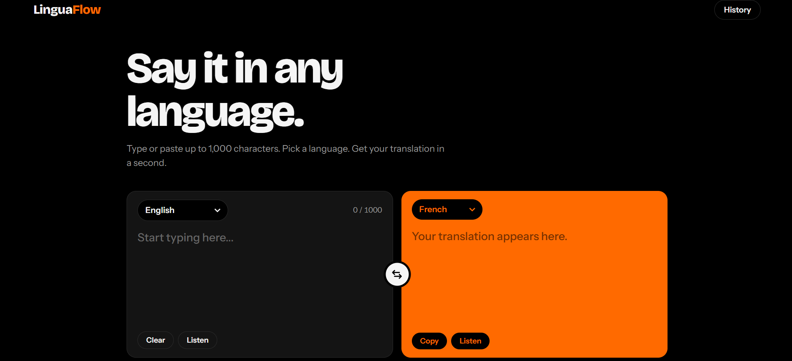

🌍 LinguaFlow

A real-time language translator web app. Type or paste text, pick a language, and get an instant translation.

🔗 **Live Demo:** https://linguaflow-static.vercel.app/

✨ Features

- Real-time text translation between multiple languages
- Clean, modern interface (black & orange theme)
- Responsive design (desktop and mobile)
- Lightweight: no framework, no build step

🛠️ Built With

- HTML5
- CSS3
- JavaScript (vanilla)
- Translation API (fetch)

📁 Project Structure

```
linguaflow-static/
├── index.html
├── style.css
└── app.js
└── README.md
└── linguaflow.png

```

🚀 Run Locally

```bash
git clone https://github.com/LoonaLabs/linguaflow-static.git
cd linguaflow-static
```

Then open `index.html` in your browser (or use the VS Code *Live Server* extension).

📸 screenshot 



👩‍💻 Author

Loubna, Full-Stack Web Developer
GitHub: [@LoonaLabs](https://github.com/LoonaLabs)
